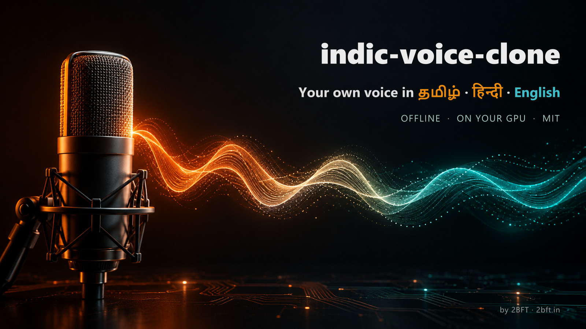

<p align="center"></p>

# indic-voice-clone

**Clone your own voice in Tamil, Hindi and English, fully offline on your own NVIDIA GPU.** Record about 12 seconds per language, then type any script and hear it in your voice. Made for creators who make reels, ads and podcasts in Indian languages.

[](LICENSE)     

## Why this exists

Cloud voice tools charge per character and send your voice to someone else's server. Good open models now exist for Indian languages, but wiring them up on Windows with a new RTX 50-series card breaks in half a dozen ways. This repo is the working setup, with every fix baked into one install script.

## Results on a real voice

Measured on one creator's own recordings (10-14 s reference per language), with lines the creator never recorded. Similarity is the cosine score of Resemble's speaker encoder: the creator's two real takes score 0.90-0.93 against each other; a different person scores about 0.60.

| Language | Engine | Similarity to the real voice | Words read back by Whisper |
|---|---|---|---|
| Tamil | AI4Bharat IndicF5 | **0.94** | near word-perfect |
| Hindi | AI4Bharat IndicF5 | **0.93** | word-perfect |
| English | Resemble Chatterbox | **0.94** | word-perfect |

Tested on Windows 11, RTX 5070 Ti (16 GB), PyTorch 2.8 + CUDA 12.8. A 15-second line takes a few seconds on the GPU.

Hear it: `examples/test_*.wav` are synthetic reference voices and `examples/clone_*.wav` are new lines cloned from them (no real person's voice is shipped in this repo).

## Install (Windows + NVIDIA)

Needs [uv](https://docs.astral.sh/uv/), ffmpeg and git on PATH, and an NVIDIA driver 570 or newer.

```powershell
git clone https://github.com/2boysfromtown/indic-voice-clone
cd indic-voice-clone
powershell -ExecutionPolicy Bypass -File install.ps1
```

IndicF5 is gated: accept its terms at [huggingface.co/ai4bharat/IndicF5](https://huggingface.co/ai4bharat/IndicF5) (instant), then log in once:

```powershell
chatterbox\.venv\Scripts\hf.exe auth login
```

## Use

1. Record yourself, 25-30 s per language, using [the recording scripts](examples/RECORDING-SCRIPTS.md). Save into `recordings/`.
2. Make a reference clip and transcript:
   ```powershell
   python -I scripts/prepare_ref.py recordings/me_ta_ad.m4a --name me_ta_ad --lang ta
   ```
   Check `refs/me_ta_ad.txt` matches what you said.
3. Speak:
   ```powershell
   python -I scripts/speak.py --lang ta --text "வணக்கம் மக்களே! இந்த சண்டே நம்ம புது ஒர்க்ஷாப் இருக்கு."
   python -I scripts/speak.py --lang hi --text "दोस्तों, इस संडे हमारा नया वर्कशॉप है।"
   python -I scripts/speak.py --lang en --text "Hey makers, our new workshop drops this Sunday."
   ```
   Output lands in `out/`, loudness-normalised to -16 LUFS, ready to drop under a video.

### Use it from Claude Code

Install the skill and just ask Claude for a voiceover "in my voice":

```bash
npx skills add 2boysfromtown/indic-voice-clone --global --agent claude-code
```

## How it works

```
your recording ──► prepare_ref.py ──► refs/me_ta_ad.wav + .txt (cut at a natural pause, transcribed)
                                              │
script text ──► speak.py ──► splits sentences ─┤
                               ├─ ta / hi ──► IndicF5   (AI4Bharat, MIT)
                               └─ en ──────► Chatterbox (Resemble AI, MIT)
                                              │
                                     joined, paused, -16 LUFS ──► out/*.wav
```

## Fixes baked into install.ps1

| Problem | Fix |
|---|---|
| RTX 50-series (Blackwell) unsupported by the PyTorch 2.6 Chatterbox pins | PyTorch 2.8 + cu128 override |
| IndicF5 crashes with "Tensor on device cpu is not on the expected device meta" | pin `transformers==4.49.0`, `datasets<3.4` |
| Chatterbox watermarker fails: `No module named pkg_resources` | `setuptools<81` |
| Big wheel downloads time out | `UV_HTTP_TIMEOUT=300` |
| Small C: drive fills up | Python, packages and models live inside the repo folder |

## What it can't do (yet)

- English through IndicF5: the voice is right but the words are gibberish, so English always uses Chatterbox.
- Whisper can't transcribe romanised Tanglish; write Tamil reference transcripts in Tamil script by hand.
- Linux/macOS install script (the Python parts are cross-platform; PRs welcome).

## Just want a ready-made voice? (optional)

This project is about cloning *your own* voice, offline and free. If instead you only need a quick stock voice and don't mind a paid cloud API, two drop-in alternatives return a WAV you can use the same way:

- [Sarvam AI](https://www.sarvam.ai) Bulbul: stock voices for Tamil, Hindi and other Indian languages.
- [ElevenLabs](https://elevenlabs.io): stock and cloned voices across many languages.

Both are suggestions, not part of the workflow here. The local models above need no key and no internet once installed.

## Responsible use

Clone only your own voice, or someone who has agreed in writing. Chatterbox embeds Resemble AI's inaudible Perth watermark in its output.

## Credits

- [AI4Bharat IndicF5](https://huggingface.co/ai4bharat/IndicF5) (MIT) for Indian-language voice cloning.
- [Resemble AI Chatterbox](https://github.com/resemble-ai/chatterbox) (MIT) for English and the speaker encoder.
- [faster-whisper](https://github.com/SYSTRAN/faster-whisper) for transcripts.
- The synthetic reference voices in `examples/` were generated with [Sarvam AI](https://www.sarvam.ai) Bulbul.

---

Built by **[2BFT, Two Boys From Town](https://2bft.in)**, a free AI school from Vaniyambadi, Tamil Nadu. Follow [@navaratan.ai](https://instagram.com/navaratan.ai) for more tools like this.
